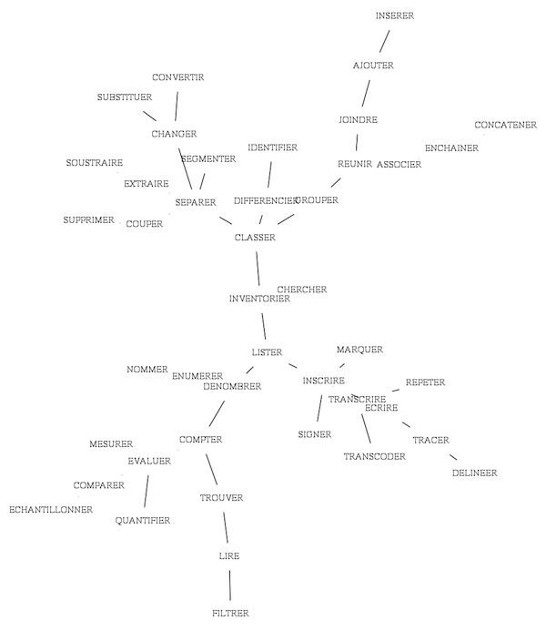

# fv-morphologie

**Outils pour la description et l'étude morphologique de transcriptions musicales.**
Version Common Lisp.

Frédéric Voisin, 1994–2013 (tutoriel PWGL, version 20131111), version Common
Lisp 2026.

> Ce document est la version de référence de la documentation. , adapté à Common Lisp. Tous les
> exemples ont été exécutés avec SBCL. Les points restant à mettre à jour sont
> listés à la fin, dans les [Notes pour la mise à jour](#notes-pour-la-mise-à-jour).
> Il reprend et développe le tutoriel intial de PWGL conservé dans
> [`pwgl-legacy/tutorial/`](../pwgl-legacy/tutorial/). 
> Une version anglaise est disponible : [fv-morphologie.md](fv-morphologie.md).

## Sommaire

- [Présentation](#présentation)
  - [Historique : l'analyse contrastive et Morphologie](#historique--lanalyse-contrastive-et-morphologie)
  - [Cadre théorique](#cadre-théorique)
  - [Remerciements](#remerciements)
- [Installation et chargement](#installation-et-chargement)
- [Menu](#menu)
- [1. Transcription](#1-transcription)
  - [1.1 Transcoder](#11-transcoder)
  - [1.2 Filtrer](#12-filtrer)
  - [1.3 Délinéer : graphes](#13-délinéer--graphes)
- [2. Classification](#2-classification)
  - [2.1 Segmenter](#21-segmenter)
  - [2.2 Concaténer](#22-concaténer)
  - [2.3 Différencier](#23-différencier)
- [3. Évaluation](#3-évaluation)
  - [3.1 Énumérer](#31-énumérer)
  - [3.2 Comparer : distances et dissimilarités](#32-comparer--distances-et-dissimilarités)
  - [3.3 Quantifier : information](#33-quantifier--information)
- [4. Lecture et écriture de fichiers](#4-lecture-et-écriture-de-fichiers)
- [5. FV-exemples](#5-fv-exemples)
- [Références](#références)
- [Liste des fonctions](#liste-des-fonctions)
- [Notes pour la mise à jour](#notes-pour-la-mise-à-jour)

## Présentation

fv-morphologie est une collection d'outils pour l'analyse d'énoncés musicaux
représentés par des suites de symboles (notations, transcriptions,
représentations symboliques ou numériques, etc.) : segmentation, recherche de
motifs et de traits saillants, reconnaissance de « formes » musicales,
comparaison de structures, classification automatique…

Comme en Lisp, un objet ou une séquence musicale est représenté ou décrit ici
par des **listes**, structurées ou non, de manière plus ou moins explicitée par
leur contexte. Par convention, une séquence musicale ou une suite de symboles
est une liste ordonnée qui commence, à gauche, par l'élément le plus ancien.
Par exemple, la liste `(60 65 70 72)` peut représenter, selon l'analyse, les
notes do fa si♭ do (standard MIDI), un accord de quatre notes (arbitrairement
du grave à l'aigu), une variation d'intensité, etc.

Cette version, commencée en 2007 pour l'enseignement de l'informatique
musicale (Conservatoire de Montbéliard, 2007–2012), est une réécriture de
*Morphologie* pour OpenMusic (Ircam), avec un portage dans PWGL (Mikael
Laurson, Académie Sibelius). Elle reprend le code consacré à l'analyse et à la
classification de données (cf. Baboni-Schilingi & Voisin, *Librairie
Morphologie pour OpenMusic*, Ircam Forum, 1997), dans un cadre théorique que
nous avons tenté d'expliciter, pragmatiquement.

Les opérations d'analyse sont regroupées en trois familles, qui forment la
structure du menu : **transcription**, **classification**, **évaluation**. Ce
regroupement résulte lui-même d'une analyse, avec fv-morphologie, du champ
sémantique couvert par ces opérations (cf.
`pwgl-legacy/tutorial/5. FV-exemples/delineations/`) :



*Les opérations de fv-morphologie : arbre de recouvrement minimal des verbes
qui les nomment, tracé avec `graph-span` et `graph>dot` (cf. Voisin, « De la
brousse dans les synthés », in P. Criton & J.-M. Chouvel (éd.), *Gilles
Deleuze : la pensée-musique*, CDMC, 2015).*

### Historique : l'analyse contrastive et Morphologie

La partie analytique de fv-morphologie repose sur l'**analyse contrastive**,
une méthode d'analyse musicale conçue et expérimentée de 1992 à 1997 environ
au département d'ethnomusicologie du LACITO-CNRS, dirigé par Simha Arom. Elle
a été élaborée sur les chants de trois communautés : les Wayana (avec Hervé
Rivière), les Bochimans Ju|'hoansi de Namibie (avec Emmanuelle Olivier) et les
Inuit d'Ammassalik, au Groenland, ces derniers à partir d'enregistrements
réalisés en 1935 par Paul-Émile Victor et Robert Gessain (analyse : Frédéric Voisin).

L'analyse contrastive est une systématisation et une généralisation de
l'*analyse paradigmatique* de Nicolas Ruwet (Ruwet 1972), dans la lignée de la
sémiologie musicale de Jean-Jacques Nattiez et de Jean Molino (Nattiez 1987 ;
Molino 2009). En ne s'appuyant que sur le "niveau neutre", elle se veut agnostique.
Elle extrait et décrit les structures de suites de symboles arbitraires (d'abord 
des mélodies) selon un critère unique : la répétition d'un contraste, ou *marque*.
Chaque symbole d'une séquence ouvre des segments, et les répétitions de ces segments
donnent une structure (voir [`mark-structure`](#mark-structure-seq-out-key-diss-rem-loc-dup-test)). Des
segments qui ne sont pas strictement identiques peuvent être comparés au moyen
de la distance d'édition.

Sa formalisation informatique s'est faite d'abord à la main, puis vers 1994
dans l'environnement de composition assistée par ordinateur Patchwork (Mikael
Laurson, Ircam), puis en Lisp. En 1997, à l'Ircam, elle est devenue la partie
analytique de *Morphologie*, librairie pour OpenMusic écrite avec Jacopo
Baboni-Schilingi, où elle s'est alliée à ses procédés génératifs
(Baboni-Schilingi & Voisin 1997, 1999 ; Voisin 1997). Morphologie a ensuite
été portée dans PWGL (Académie Sibelius), et son code original est toujours
maintenu pour OpenMusic 6 et 7
(<https://github.com/openmusic-project/Morphologie>).

Le principe de contraste a été étendu en ceux de *nouveauté*
(*New/Old-Analysis*) et d'*énergie* (*Energy-profile*), une énergie qui résulte
du cumul progressif des contrastes (Paolo Aralla, à partir de l'analyse de
partitions de Bach, Beethoven et Webern avec Morphologie ; Aralla 2002). Ce
développement est repris ici dans la fonction
[`inner-dynamic`](#inner-dynamic-seq-optional-test).

Voir aussi, sur fredvoisin.com :
[« Présentation de l'analyse "contrastive" »](https://fredvoisin.com/articles/50-presentation-de-l-analyse-contrastive.html),
[« Présentation de Morphologie »](https://fredvoisin.com/articles/28-presentation-de-morphologie.html),
[« Autour d'une analyse de chants inuit »](https://fredvoisin.com/articles/20-autour-d-une-analyse-de-chants-inuit.html),
[« Analyse contrastive en Scheme »](https://fredvoisin.com/articles/47-analyse-contrastive-en-scheme.html),
[« cntrst-strct »](https://fredvoisin.com/articles/122-cntrst-strct.html),
[« Analysi morfologica, de Paolo Aralla »](https://fredvoisin.com/articles/264-analysi-morfologica-de-paolo-aralla.html).

### Cadre théorique

Le terme de *morphologie* s'inspire d'abord de l'idée de morphogenèse de René
Thom (Thom 1977). La morphologie musicale est entendue ici comme *l'étude de
formes d'expressions musicales transcrites* — écritures ou transcriptions de
phénomènes sonores, mais aussi gestes musicaux, voire chorégraphiques (cf. [LabanOnLisp](https://github.com/FredVoisin/LabanOnLisp)) — et
comme une extension de l'analyse paradigmatique (Ruwet 1972 ; Nattiez 1987 ;
Molino 2009), dont l'un des principaux
objets est d'expliciter les critères de segmentation et de ressemblance des
motifs musicaux. Les outils s'appliquent aux expressions telles qu'elles sont
transcrites : le choix du niveau sémiologique et la pertinence de la
transcription, autrement dit de l'**encodage**, sont laissés au musicologue ou
au compositeur, même si les outils permettent de les mettre à l'épreuve.

D'autres concepts viennent d'André Leroi-Gourhan (la *chaîne opératoire* du
façonnage des outils ; Leroi-Gourhan 1964–1965) et de Gilles Deleuze
(répétition, différenciation, machine, rhizome, signature ; Deleuze 1968 ;
Deleuze & Guattari 1980). D'autres principes sont empruntés à la morphologie
mathématique, à l'informatique, à la théorie de l'information et à la théorie
des graphes, et adaptés à l'analyse musicale. La terminologie évite les termes
musicaux fortement connotés et a été choisie pour être équivalente en français
et en anglais.

Voir [« Considération terminologiques »](https://fredvoisin.com/articles/188-consideration-terminologiques.html),
[« Schizo-analyse et musicologie »](https://fredvoisin.com/articles/125-schizo-analyse-et-musicologie.html) et
[« Deux machines à musiquer »](https://fredvoisin.com/articles/178-deux-machines-a-musiquer.html) (colloque
*Deleuze et la musique*, Saint-Étienne, 2011).

À propos :

- Ancienne page de documentation de fv-morphologie (PWGL) : [« fv-morphologie: documentation »](https://fredvoisin.com/articles/114-fv-morphologie-documentation.html)
- *Dissemblance et espaces compositionnels* (Frédéric Voisin, JIM 2011) :
  [« Dissemblance et espaces compositionnels »](https://fredvoisin.com/articles/185-dissemblance-et-espaces-compositionnels.html)
- Code original (~1995) : <https://github.com/openmusic-project/Morphologie>

### Remerciements

Je tiens à remercier [Hervé Rivière](https://lacito.cnrs.fr) et
[Emmanuelle Olivier](http://centregeorgsimmel.ehess.fr/en/membres/membres-statutaires/emmanuelle-olivier/)
(LACITO-CNRS), avec qui l'analyse contrastive a été conçue, ainsi que
[Jacopo Baboni-Schilingi](https://ressources.ircam.fr/en/composer/jacopo-baboni-schilingi),
[Giacomo Platini](https://www.villacomposers.org/composers/platini-giacomo-1967-gattinara.php),
[Paolo Aralla](https://www.milanomusica.org/archivio/artisti/paolo-aralla-1960/),
[Carlo Ciceri](https://ensemblevortex.com/members/composer/carlo-ciceri),
[Kilian Sprotte](http://kiliansprotte.de/lisp/),
[Julien Vincenot](https://brahms.ircam.fr/en/julien-vincenot),
[Mikael Laurson](http://www2.siba.fi/PWGL/) (« Mika »),
[Gérard Assayag](https://www.ircam.fr/person/gerard-assayag) et
[Carlos Agon](http://recherche.ircam.fr/equipes/repmus/Rapports/CarlosAgon98/index.html)
pour leurs contributions et nos échanges.

## Installation et chargement

La librairie est un système ASDF sans autre dépendance qu'ASDF/UIOP. Clonez
le dossier du projet, ou créez-en un lien symbolique, dans
`~/quicklisp/local-projects/` (ou `~/common-lisp/` pour ASDF seul), puis :

```lisp
(ql:quickload :fv-morphologie)      ; ou (asdf:load-system :fv-morphologie)
(in-package :fv-morphologie)
```

Tous les exemples ci-dessous sont évalués dans le paquet `:fv-morphologie`.

- `graph>dot` a besoin de [Graphviz](https://graphviz.org/) (`neato`) pour
  produire des images.
- Les tests utilisent [FiveAM](https://github.com/lispci/fiveam), uniquement
  pour tester le code : `(ql:quickload :fv-morphologie/tests)` puis
  `(asdf:test-system :fv-morphologie)`.

Dans PWGL et OpenMusic, fv-morphologie nécessitait la bibliothèque
[ompw](http://kiliansprotte.de/lisp/#ompw) (Kilian Sprotte) ; la version
Common Lisp, non.

## Menu

```
;;; 1. TRANSCRIPTION
;;  1.1 TRANSCODER : convertir, encoder, tracer
       transcode, num>base, num>alpha, alpha>num, list>sym, str->symb, filt-noise
;;  1.2 FILTRER
       filt-median, filt-mean, filt-lowpass, filt-local-rep, filt-fct
;;  1.3 DÉLINÉER : tracer des graphes
       graph-span, graph-path, graph>dot
;;; 2. CLASSIFICATION
;;  2.1 SEGMENTER : couper, scinder
       exsample, separate, graph-part
;;  2.2 CONCATÉNER : grouper, assembler
       motif-group, list>sym
;;  2.3 DIFFÉRENCIER : classer, identifier
       mark-structure, motif-structure, class-num, class-sym
;;; 3. ÉVALUATION
;;  3.1 ÉNUMÉRER : échantillonner, trouver, compter
       mark-position, mark-list, motif-find, motif-list, graph-nodes, graph-extrem
;;  3.2 COMPARER : distances et dissimilarités
       dist-euclidian, dist-citybloc, dist-hamming, dist-edit,
       dist-multi-edit, dist-structure, dist-graph
;;  3.3 QUANTIFIER : information propre
       histogram, entropy, elt-info, inner-dynamic, graph-length, graph-degree
;;; 4. LIRE/ÉCRIRE des fichiers
       read-text, write-list, display-list
```

Dans le REPL, `(doc)` liste les fonctions documentées et `(doc 'dist-edit)`
affiche la documentation de l'une d'elles (depuis n'importe quel paquet :
`'dist-edit`, `:dist-edit` ou `"dist-edit"`). `(help 'graph)` cherche un mot
dans les noms et la documentation des fonctions : elle affiche la
documentation des fonctions trouvées, les plus proches d'abord, et renvoie
leurs noms ; un second argument fixe le seuil de similarité (0,75 par défaut,
de 0 à 1).

Les docstrings des fonctions, affichées par `doc` et `help`, sont en anglais.

## 1. Transcription

### 1.1 Transcoder

Différentes sortes de transcodage : des symboles aux nombres et inversement,
entre bases numériques, des listes aux symboles.

#### `transcode (seq table &optional test)`

Remplace chaque élément de `seq` trouvé dans `table`, une liste de paires
`(ancien nouveau)`. Les éléments absents de la table sont conservés. Le test
par défaut est `#'eq`.

```lisp
(transcode '(a b c a) '((a x) (c z)))                  ;=> (X B Z X)
(transcode '(c d e) *very-minimalist-midi-notes* #'string-equal)
;=> (72 62 64)
```

#### `num>base (num base)`

Convertit un nombre, ou une liste de nombres, en base `base` (0 si la base est
inférieure à 2). Si `base` vaut `nil`, les nombres sont écrits en toutes
lettres, en anglais. Si `base` est une liste, donne un résultat par base.

```lisp
(num>base 10 2)          ;=> 1010
(num>base 255 16)        ;=> FF
(num>base 5 '(2 3))      ;=> (101 12)
(num>base 10 nil)        ;=> TEN
```

#### `num>alpha (num)`

Convertit des entiers positifs ou nuls en lettres : 0 → A, 1 → B, …, 25 → Z,
26 → AA.

```lisp
(num>alpha '(0 1 27))    ;=> (A B AB)
```

#### `alpha>num (char &optional mode)`

Convertit des symboles ou des chaînes en codes de caractères (ASCII). Avec le
mode `:midi`, convertit un nom de note (A à G) en hauteur MIDI.

```lisp
(alpha>num 'abc)         ;=> (65 66 67)
(alpha>num "abc")        ;=> (97 98 99)
(alpha>num "C" :midi)    ;=> 72
```

#### `list>sym (list)`

Concatène une liste plate en un seul symbole, nombre ou chaîne, selon le type
de ses éléments.

```lisp
(list>sym '(a b c))      ;=> ABC
(list>sym '(1 2 3))      ;=> 123
```

#### `str->symb (strings)`

Lit une chaîne (ou une liste de chaînes) comme une liste (ou des listes) de
symboles.

```lisp
(str->symb "a b c")          ;=> (A B C)
(str->symb '("a b" "c"))     ;=> ((A B) (C))
```

#### `filt-noise (seq &optional mode val)`

*Boîte PWGL : `randomize`.* Bruite une séquence ou en perturbe l'ordre, selon
`mode`, avec la quantité `val` (0,1 par défaut) rapportée à l'étendue
(max − min) de `seq` :

- `:nozero` (par défaut) : remplace chaque zéro par une valeur aléatoire dans
  ]0, `val` × étendue[ (]0, `val`[ si toutes les valeurs sont égales) ; les
  autres valeurs sont conservées ;
- `:swap` : permute `val` × longueur paires d'éléments (un `val` entier donne
  le nombre de permutations) ;
- `:relative` : ajoute à chaque valeur une quantité aléatoire dans
  [−`val` × étendue, `val` × étendue].

`mode` peut aussi être une fonction de deux arguments `(x l)` (`#'nom` ou une
`lambda`, pas un symbole quoté) : chaque élément `x` de `seq` est remplacé par
son résultat, `l` étant toute la séquence `seq` (une copie, partagée par tous
les appels : la fonction ne doit pas la modifier), et `val` est ignoré. On
applique ainsi n'importe quel bruit, numérique ou non, élément par élément ;
déclarez `(declare (ignore x))` ou `(declare (ignore l))` pour un argument
inutilisé.

Une séquence non numérique est permutée (`:swap`). Un autre mode est une
erreur ; `seq` elle-même n'est pas modifiée.

```lisp
(filt-noise '(0 5 0 10))                  ;=> (0.10159576 5 0.14144969 10)
(filt-noise '(100 200 0 50) :relative 0.1) ;=> (81.438194 194.18185 -5.740862 65.08263)
(filt-noise '(60 62 64) (lambda (x l) (declare (ignore l)) (+ x (random 2))))
;=> (61 62 65)
;; chaque élément remplacé par un élément aléatoire de la liste
(filt-noise '(a b c d) (lambda (x l) (declare (ignore x)) (nth (random (length l)) l)))
;=> (C A C D)
```

### 1.2 Filtrer

#### `filt-median (seq window)`

Médiane glissante sur `window` valeurs centrées sur chaque valeur : supprime
les pics plus étroits que la moitié de la fenêtre, et conserve en place les
marches et les rampes. La fenêtre est impaire, pour que la médiane soit
toujours la valeur du milieu et que le résultat ne contienne que des valeurs
de `seq` : une fenêtre paire est portée à la taille impaire suivante (4 donne
5). Aux bords, la première et la dernière valeur sont répétées (un pic sur la
toute première ou la toute dernière valeur est donc conservé). Le résultat a
la même longueur que `seq`.

```lisp
(filt-median '(1 9 1 1 1 9 1) 3)          ;=> (1 1 1 1 1 1 1)
(filt-median '(0 0 9 9 0 0 0) 3)          ;=> (0 0 9 9 0 0 0)
(filt-median '(0 0 0 9 9 0 0 0 0) 5)      ;=> (0 0 0 0 0 0 0 0 0)
(filt-median '(9 0 0 0) 3)                ;=> (9 0 0 0)
```

#### `filt-mean (seq wind &optional step)`

Moyenne glissante sur `wind` valeurs (un entier, ou un flottant exprimant une
fraction de la longueur de `seq`).

- Avec `step` 1 (par défaut), la fenêtre est centrée sur chaque valeur : une
  fenêtre paire est portée à la taille impaire suivante et, aux bords, la
  fenêtre se réduit symétriquement ; la première et la dernière valeur sont
  donc conservées et les rampes restent inchangées.
- Avec un `step` plus grand, la moyenne d'une fenêtre de `wind` valeurs
  centrée sur chaque bloc de `step` valeurs est répétée pour tout le bloc ;
  avec `step` = `wind`, chaque bloc est remplacé par sa moyenne. Un `step`
  flottant est une fraction de `wind`.

Le résultat a la même longueur que `seq`.

```lisp
(filt-mean '(0 0 0 9 0 0 0) 3)           ;=> (0.0 0.0 3.0 3.0 3.0 0.0 0.0)
(filt-mean '(1 2 3 4 5 6) 3)             ;=> (1.0 2.0 3.0 4.0 5.0 6.0)
(filt-mean '(1 2 3 4 5 6 7 8 9) 3 3)     ;=> (2.0 2.0 2.0 5.0 5.0 5.0 8.0 8.0 8.0)
```

#### `filt-lowpass (seq alpha &optional gamma)`

*Boîte PWGL : `filt-exponential`.* Lissage exponentiel : chaque valeur se
déplace de la fraction `alpha` (entre 0 et 1) vers l'entrée :
s(t) = s(t−1) + α (x(t) − s(t−1)), à partir de s(0) = x(0).

Avec `gamma` (entre 0 et 1), lissage exponentiel double (Holt), qui suit
aussi la tendance b de la séquence :
s(t) = α x(t) + (1 − α) (s(t−1) + b(t−1)) et
b(t) = γ (s(t) − s(t−1)) + (1 − γ) b(t−1), à partir de s(0) = x(0) et
b(0) = x(1) − x(0). Une séquence constante ou linéaire reste alors inchangée.

Le résultat a la même longueur que `seq`.

```lisp
(filt-lowpass '(0 10 0 10 0) 0.5)        ;=> (0 5.0 2.5 6.25 3.125)
(filt-lowpass '(0 10 0 10 0) 0.5 0.5)    ;=> (0 10.0 10.0 12.5 8.125)
(filt-lowpass '(0 1 2 3 4 5) 0.5 0.5)    ;=> (0 1.0 2.0 3.0 4.0 5.0)
```

#### `filt-local-rep (seq &optional mode test)`

Supprime les éléments identiques consécutifs (comportement par défaut, ou
mode `:delete`).

Pour les séquences numériques, le mode `:linear` (ou `:interp`, son nom dans
PWGL) conserve la longueur de la séquence : chaque suite de valeurs
identiques est remplacée par une rampe allant de sa valeur à la valeur
différente suivante ; la dernière suite est conservée telle quelle. Pour les
séquences non numériques, `:linear` supprime les répétitions comme `:delete`.
`seq` elle-même n'est jamais modifiée ; un autre mode est une erreur.

`test` définit l'identité des éléments (`#'equalp` par défaut), par exemple
pour traiter des valeurs proches comme identiques.

```lisp
(filt-local-rep '(a a b b b c a b b a a))      ;=> (A B C A B A)
(filt-local-rep '(0 0 1 2 2 2 3 3 0 0))        ;=> (0 1 2 3 0)
(filt-local-rep '(0 0 1 2 2 2 3 3 0 0) :linear)
;=> (0.0 0.5 1 2.0 2.3333333 2.6666667 3.0 1.5 0 0)
```

#### `filt-fct (seq func wind &optional step)`

Applique la fonction `func` à une fenêtre glissante de `wind` valeurs, par pas
de `step` (1 par défaut). `wind` est un entier (nombre de valeurs) ou une
fraction de la longueur de `seq` ; `step` est un entier ou une fraction de
`wind`. Les fenêtres sont placées comme pour `filt-mean` :

- avec `step` 1, la fenêtre est centrée sur chaque valeur (une fenêtre paire
  est portée à la taille impaire suivante) et se réduit symétriquement aux
  bords ;
- avec un `step` plus grand, la fenêtre est centrée sur chaque bloc de `step`
  valeurs.

Ce que renvoie `func` donne les valeurs de la position ou du bloc :

- une valeur (`nil` compris) est répétée pour tout le bloc ;
- une liste remplace le bloc quand la fenêtre est le bloc (`step` = `wind`),
  quelle que soit sa longueur : `func` peut alors réordonner, ajouter ou
  supprimer des valeurs ;
- sinon, une liste doit avoir la longueur de la fenêtre, et ses valeurs aux
  positions du bloc sont conservées.

Le résultat a la même longueur que `seq`, sauf quand des listes d'une autre
longueur remplacent des blocs entiers.

```lisp
(filt-fct '(0 0 0 9 0 0 0 0) (lambda (w) (apply #'max w)) 3)
;=> (0 0 9 9 9 0 0 0)
(filt-fct '(1 2 3 4 5 6 7 8) #'reverse 3 3)
;=> (3 2 1 6 5 4 8 7)
```

### 1.3 Délinéer : graphes

*Délinéation : tracés, plans, projections, relevés.*

Les graphes sont un moyen commode et puissant de représenter et d'étudier de
grands ensembles de données, ainsi que les relations et la classification
d'objets arbitraires.

Dans fv-morphologie, une arête (segment) d'un graphe est une liste formée d'un
nœud, d'un autre nœud et de la distance qui les sépare, par exemple
`(A B 1.5)`. Un graphe est une liste d'arêtes :

```lisp
((A B 1.5) (B C 2.1) (B D 3.2) ...)
```

C'est la même forme que la *semi-matrice de distances* renvoyée par les
fonctions de distance (voir [3.2](#32-comparer--distances-et-dissimilarités)),
`(i j d(i,j))` : le résultat d'une fonction de distance peut donc servir de
graphe.

#### `graph-span (mat-dist &optional verbose)`

Arbre de recouvrement minimal d'un ensemble d'objets, déduit de la
semi-matrice de leurs distances : l'ensemble minimal d'arêtes
`(obj-A obj-B distance)` nécessaire pour tracer l'arbre, de longueur totale
minimale. Il est calculé avec l'algorithme de Kruskal : les arêtes sont prises
par distance croissante, et conservées lorsqu'elles relient deux parties pas
encore reliées. Le résultat est déterministe : les arêtes sont données par
distance croissante et, à distances égales, les premières arêtes de
`mat-dist` sont préférées. Les objets peuvent être de n'importe quel type
(comparés avec `equal`). Si les objets ne sont pas tous reliés, le résultat
est une forêt de recouvrement minimal, un arbre par partie connexe, et un
message le signale.

(Les versions antérieures utilisaient l'algorithme de Prim, d'après Diday et
al., *Éléments d'analyse de données*, Dunod, 1982, à partir d'un objet de
départ aléatoire : à distances égales, l'arbre pouvait changer d'un appel à
l'autre.)

```lisp
(graph-span '((0 1 1) (0 2 4) (1 2 2) (2 3 1)))
;=> ((0 1 1) (2 3 1) (1 2 2))     ; l'arête (0 2 4) n'est pas nécessaire
```

Dans le tutoriel PWGL (`1.3.1_graph-span`), des profils mélodiques aléatoires
sont comparés entre eux par la distance d'édition de leurs signatures, et
`graph-span` donne l'arbre de leurs ressemblances.

#### `graph-path (from to graph)`

Les nœuds du chemin entre deux nœuds d'un arbre (`nil` s'ils ne sont pas
reliés). Dans un graphe qui n'est pas un arbre, c'est le plus court chemin en
distance (algorithme de Dijkstra ; les distances doivent être positives ou
nulles). Seuls les deux nœuds de chaque arête `(nœud-a nœud-b distance)` sont
comparés, jamais la distance. Les nœuds sont comparés avec `equal` : les
chaînes sont sensibles à la casse, et les nœuds ne peuvent pas être des
listes (une liste représente plusieurs nœuds).

- `from` ou `to` à `nil` : les chemins de l'autre nœud vers chaque feuille de
  l'arbre.
- `from` et `to` à `nil` : les chemins entre toutes les paires de feuilles.
- `from` et/ou `to` liste de nœuds : les chemins pour chacun d'eux.

```lisp
(graph-path 'a 'c '((a b 1) (b c 2) (b d 1)))   ;=> (A B C)
(graph-path 'a 'b '((a b 1) (b c 2) (b d 1)))   ;=> (A B)
(graph-path 'a nil '((a b 1) (b c 2) (b d 1)))  ;=> ((A B C) (A B D))
(graph-path nil nil '((a b 1) (b c 2) (b d 1))) ;=> ((A B C) (A B D) (C B D))
```

#### `graph>dot (graph out &key dis scale shape legend)`

Trace un graphe non orienté au format **dot**.

Tracer automatiquement de grands graphes, de manière lisible et agréable, est
un problème complexe et encore un sujet de recherche. Le langage dot décrit
des graphes (orientés ou non) dans des fichiers texte (`.dot`) ; il est
utilisé par plusieurs logiciels libres, sur toutes les plateformes.

`neato` (Stephen C. North, laboratoires AT&T) trace des graphes non orientés.
Il repose sur un modèle physique qui cherche itérativement des équilibres
stables ou métastables entre des forces attachées aux nœuds (cf. Kamada &
Kawai, *Information Processing Letters* 31:1, 1989). Le calcul peut être long
et, son état initial étant aléatoire, le tracé peut différer d'une exécution à
l'autre. neato peut écrire des fichiers png, gif ou svg ; le svg est
préférable pour les grands graphes. neato fait partie de
[Graphviz](https://graphviz.org/)
([guide de neato](https://graphviz.org/pdf/neatoguide.pdf)).

Arguments :

- `out` : `t` ou `nil` affiche le texte dot dans le listener ; un flux (stream)
  y écrit ; un chemin écrit un fichier `.dot` et, sauf si son type est `dot`,
  lance aussi `neato` pour produire l'image au format de son type (`svg`,
  `pdf`, `png`, `gif`…, `png` sans type). Si `neato` ne peut pas être lancé,
  le fichier `.dot` est tout de même écrit, et une erreur le signale.
- `:dis` : de combien le tracé peut déformer les longueurs (0.0–1.0), transmis
  à `neato` comme attribut `w` des arêtes.
- `:scale` : échelle de l'arête la plus courte, pour tracer les arêtes de
  longueur 0 (un nombre ; `t` vaut 1, `nil` 0.2).
- `:shape` : forme des nœuds (un nom de forme Graphviz comme `"ellipse"`,
  `"plaintext"`, `"point"`), ou une liste de deux formes : nœuds ordinaires,
  et nœuds reliés par des arêtes de longueur nulle.
- `:legend` : étiqueter les arêtes avec leur longueur (`t` par défaut).

Les arêtes de longueur 0 sont tracées en bleu, avec la longueur de la plus
courte autre arête multipliée par `:scale` (ou `:scale` si toutes les arêtes
sont de longueur 0).

```lisp
(graph>dot '((a b 1) (a c 2) (b d 0)) "/tmp/graph.png")
;=> "/tmp/graph.png"     ; écrit /tmp/graph.dot et /tmp/graph.png
```

Le fichier dot peut aussi être tracé à la main :
`neato -Tpng graph.dot -o graph.png`.

## 2. Classification

Les fonctions de ce groupe différencient les éléments ou les motifs d'une
séquence selon divers critères ou procédés :

- **segmentation**, selon
  - les variations d'intensité (`int-*`),
  - la répétition de marques (`mark-*`),
  - la répétition de motifs (`motif-*`) ;
- **classification** d'objets (musicaux) représentés dans un espace de
  dimension arbitraire, normé, euclidien ou symbolique (`class-*`) ;
- **concaténation** de segments prédéfinis, ou de segments obtenus par
  segmentation ou par classification.

### 2.1 Segmenter

#### `exsample (seq method thres &key diff duration out)`

*Exsample* : variante des racines étymologiques d'« exemple »,
d'« échantillon » et de l'anglais *sample* et *example*. Décrit une variation
plus ou moins continue d'intensité par ses valeurs les plus significatives.
Le taux de compression obtenu ne peut pas être prévu : il dépend à la fois de
la forme générale de la variation et de la méthode employée pour définir ce qu'est
une variation significative.

La littérature scientifique sur les séries temporelles emploie les termes de
« signature » (Hetland), de « landmarks » (Perng, Parker & Leung) ou
d'« important extrema » (Fink & Gandhi). Ils recouvrent le même sens mais
relèvent de méthodes différentes : une variation d'intensité n'a pas
nécessairement une seule signature.

La *signature* d'une variation d'intensité est l'ensemble de ses variations
les plus caractéristiques — minima, maxima et éventuellement inflexions —,
autrement dit un ensemble anomal et singulier de points saillants, ou plis.

Deleuze associe la signature à la *ritournelle* qui, « sélectionnant des
composantes de milieux qu'elle exprime, fait territoire, intensité
auto-posée, marque, signature » (*Mille plateaux*, p. 390). Elle peut aussi
être vue comme une trace, et résulter ainsi de processus d'effacement
(cf. Derrida).

Dans fv-morphologie, chaque point saillant (pli) est décrit par une liste
formée de :

- sa position dans la séquence d'origine ;
- son type : minimum (`-1`), maximum (`1`) ou inflexion - ou plateau (`0`) ;
- la valeur de la séquence à cette position.

`thres` est une amplitude absolue, dans l'unité des valeurs de `seq` : les
variations inférieures à `thres` sont ignorées (`nil` ou 0 : pas de seuil ;
un `thres` négatif est une erreur).
Méthodes :

- `:minflexmax` (par défaut, ou `nil`) : les minima, maxima et inflexions (là
  où un plateau commence et là où il finit (cf. `:duration` infra) ;
- `:minmax` : minima et maxima seulement, les extrema importants de
  `:major-extrema` (avec |a − b|) ;
- `:major-extrema` : les *important extrema* de Fink & Gandhi. Un minimum
  `a_m` est important si, sur un intervalle `a_i … a_j` qui l'entoure, il est
  la valeur la plus basse et la séquence remonte d'au moins `thres` de part et
  d'autre : diff(`a_m`, `a_i`) ≥ `thres` et diff(`a_m`, `a_j`) ≥ `thres` ;
  De même les maxima importants, inversement. Avec `thres` 0, tout
  extremum local strict est important. `:diff` donne la différence (cf. infra) ;
  la différence entre deux valeurs égales doit être 0). L'algorithme linéaire 
  de Fink & Gandhi est utilisé ; il assouplit la définition aux extrémités de la
  séquence : un extremum situé entre une extrémité et une variation d'au moins
  `thres` n'a pas besoin d'une variation de `thres` du côté de cette extrémité
  (`(0 8 1 0 2)` avec `thres` 5 donne le maximum 8 et  le minimum 0).
  D'extrema importants égaux, sans extremum de l'autre sorte entre eux, le premier
  est donné, et un extremum égal à la première valeur  de la séquence est cette
  valeur (il n'est pas donné).
- `:landmarks` : les *landmarks* de Perng, Parker & Leung. Les landmarks du
  premier ordre sont les extrema locaux ; ils sont ensuite lissés par MDPP :
  une paire de landmarks consécutifs (x₁, y₁), (x₂, y₂) est supprimée tant que
  x₂ − x₁ < D et que leur différence, donnée par `:diff`, est inférieure à
  `thres`. D est `:duration`, un nombre de positions, non négatif (`nil` :
  aucune limite). La paire de plus petite différence est supprimée la
  première (la plus à gauche à différences égales) ; après une suppression,
  les landmarks d'avant et d'après la paire deviennent consécutifs et peuvent
  former une nouvelle paire. `(0 6 4 5 0)` avec `thres` 3 donne `((1 1 6))` :
  la paire 4, 5 (différence 1) est supprimée, et non 6, 4 (différence 2).

`:diff`, avec `:major-extrema` et `:landmarks`, est la différence entre deux
valeurs a et b :

- `:absolute` (par défaut, ou `nil`) : |a − b| ;
- `:relative` : 2|a − b| / (|a| + |b|), le pourcentage de Perng et al. ;
- une fonction lambda sur `(a b)`.

Une clé dont la méthode ne se sert pas (`:diff` avec `:minmax` ou
`:minflexmax`, `:duration` avec `:minmax` ou `:major-extrema`) est une
erreur, de même qu'une autre méthode.

Avec toutes les méthodes, un extremum plat (un plateau qui est un minimum ou
un maximum) est donné une seule fois, à sa première position ; avec
`:minflexmax`, un plateau qui n'est pas un extremum donne une inflexion là où
il commence et là où il finit.

Avec `:minflexmax`, un *plateau* est une portion d'au moins `:duration`
positions (`nil`, 0, 1 et 2 valent 2) où la séquence varie de moins de
`thres` (où elle est constante quand `thres` vaut 0) ; les plateaux sont
cherchés de gauche à droite, chacun aussi long que possible. Un plateau qui
contient un minimum ou un maximum est un extremum plat, donné une seule fois ;
tout autre plateau donne deux inflexions (type 0), à sa première et à sa
dernière position, avec les valeurs de la séquence à ces positions. Un
plateau est défini par toute son étendue : ainnsi une dérive lente dont la variation
atteint `thres` n'est pas un seul plateau. Une montée régulière de moins de
`thres` sur `:duration` positions est découpée en escalier de plateaux 
(discrétisation) ; une `:duration` plus longue l'évite.

`:out` forme du résultat :

- `:values` (par défaut, ou `nil`) : les valeurs des points, avec la première
  et la dernière valeur de `seq` ;
- `:positions` : leurs positions ;
- `:all` : les paires `(position valeur)` ;
- `:resampled` : les proportions temporelles entre les points sont
  conservées, avec une interpolation linéaire entre eux ; le résultat a le
  même nombre de valeurs que la séquence d'origine. Il s'agit d'un ré-échantillonage
  de la séquence fondé sur ses valeurs extrèmes et plateaux (ses caractéristiques) ou,
  autrement dir, sa caricature.
- `:signature` : les points `(position type valeur)`, sans la première ni la
  dernière valeur.
- Une autre valeur de `:out` donne une erreur.

```lisp
(exsample '(0 2 4 3 1 2 6 5 0) :minmax 0)                   ;=> (0 4 1 6 0)
(exsample '(0 2 4 3 1 2 6 5 0) :minmax 0 :out :positions)   ;=> (0 2 4 6 8)
(exsample '(0 2 4 3 1 2 6 5 0) :minmax 0 :out :all)
;=> ((0 0) (2 4) (4 1) (6 6) (8 0))
(exsample '(0 2 4 3 1 2 6 5 0) :minmax 0 :out :resampled)
;=> (0 2 4 5/2 1 7/2 6 3 0)
(exsample '(0 2 4 3 1 2 6 5 0) :minmax 0 :out :signature)
;=> ((2 1 4) (4 -1 1) (6 1 6))
(exsample '(0 1 3 2 2.5 1 4 8 7 7.5 3 2 5 1 0) :major-extrema 2.4 :out :signature)
;=> ((7 1 8) (11 -1 2) (12 1 5))
(exsample '(0 1 3 2 2.5 1 4 8 7 7.5 3 2 5 1 0) :landmarks 0.6 :out :signature)
;=> ((2 1 3) (5 -1 1) (7 1 8) (11 -1 2) (12 1 5))
(exsample '(0 1 3 2 2.5 1 4 8 7 7.5 3 2 5 1 0) :landmarks 0.3 :diff :relative :out :signature)
;=> ((2 1 3) (5 -1 1) (7 1 8) (11 -1 2) (12 1 5))
(exsample '(0 2 4 5 5.2 5 5.2 5 7 9) :minflexmax 1 :out :signature)  ; un plateau de 3 à 7
;=> ((3 0 5) (7 0 5))
(exsample '(0 2 4 5 5.2 5 5.2 5 7 9) :minflexmax 1 :duration 6 :out :signature)
;=> nil                                                              ; moins de 6 positions
(exsample '(0 6 3 3.2 3 3.2 3 6 0) :minflexmax 1 :out :signature)    ; un minimum plat
;=> ((1 1 6) (2 -1 3) (7 1 6))
```

Références :

- Deleuze & Guattari, *Mille plateaux*, 1980 (p. 390, la *ritournelle*).
- Derrida, *La différance – de la philosophie*, 1972 ; *L'animal que donc je
  suis*, 2004.
- Fink & Gandhi, « Important extrema in time series », *Conference on
  Systems, Man and Cybernetics*, 2007.
- Hetland, « A survey of recent methods for efficient retrieval of similar
  time sequences », in *Data Mining in Time Series Databases*, Series in
  Machine Perception and Artificial Intelligence, vol. 57, 2004.
- Perng, Parker & Leung, « Representing time series by landmarks »,
  *Conference on Information and Knowledge Management*, 1999.

#### `separate (seq &key marks keep)`

Sépare une chaîne à chacun des caractères de `:marks` (et aux blancs), ou une 
liste à ses marques : en ce cas, les éléments de la liste `:marks` (comparés 
avec `equalp`, si bien que des chaînes ou des listes peuvent être des marques),
une marque unique, ou les éléments pour lesquels le prédicat `:marks` est vrai.
Avec `:keep` `nil` (par défaut), les marques sont supprimées ; avec `:keep` `t`,
chaque marque commence le segment qui la suit, comme dans `mark-structure` (les 
blancs d'une chaîne étant toujours supprimés). Les segments vides sont supprimés.
Le résultat est une liste de segments (`nil` pour une chaîne vide).

```lisp
(separate "hello big world")                     ;=> ("hello" "big" "world")
(separate "a,b;c" :marks ",;")                   ;=> ("a" "b" "c")
(separate "a,b;c" :marks ",;" :keep t)           ;=> ("a" ",b" ";c")
(separate '(a b x c d x e) :marks '(x))          ;=> ((A B) (C D) (E))
(separate '(a b x c d x e) :marks '(x) :keep t)  ;=> ((A B) (X C D) (X E))
(separate '(1 2 3 4 1 2) :marks (lambda (x) (< x 2)))  ;=> ((2 3 4) (2))
(separate "hello")                               ;=> ("hello")
```

#### `graph-part (graph &optional mode n)`

Partitionne un arbre en supprimant sa ou ses arêtes les plus longues. Le seul
mode est `:distance` (par défaut). Expérimental.

- Sans `n`, toutes les arêtes de longueur maximale sont coupées : le nombre de
  parties dépend donc du nombre d'arêtes qui partagent cette longueur.
- Avec un entier `n`, exactement les `n − 1` arêtes les plus longues sont
  coupées (à longueurs égales, la première de l'arbre), ce qui donne `n`
  parties — jamais plus que le nombre de nœuds.

Renvoie deux valeurs : les arêtes de chaque partie (`((nœud))` pour une partie
formée d'un seul nœud), et les nœuds de chaque partie.

```lisp
(graph-part '((0 1 1) (1 2 2) (2 3 2) (3 4 1)))
;=> (((0 1 1)) ((2)) ((3 4 1)))
;   ((0 1) (2) (3 4))
(graph-part '((0 1 1) (1 2 2) (2 3 2) (3 4 1)) :distance 2)
;=> (((0 1 1)) ((2 3 2) (3 4 1)))
;   ((0 1) (2 3 4))
```

### 2.2 Concaténer

#### `motif-group (seq test &optional key)`

Regroupe dans une même liste les éléments ou motifs consécutifs de `seq` pour
lesquels la comparaison `test` réussit. `test` prend deux arguments, l'élément
précédent et le suivant (par défaut : `#'equalp`). La fonction optionnelle
`key` est appliquée à chaque élément ou motif avant la comparaison.

Par défaut, quand les éléments sont des symboles, le critère est leur
identité. Quand ce sont des listes, le critère porte à la fois sur l'identité
et sur la disposition de leurs éléments. Les éléments isolés ne sont pas mis
dans une liste.

```lisp
;; nombres identiques
(motif-group '(1 1 2 2 2 3) #'=)
;=> ((1 1) (2 2 2) 3)
;; nombres proches
(motif-group '(1 2 10 11 12 30) (lambda (a b) (< (abs (- a b)) 3)))
;=> ((1 2) (10 11 12) 30)
```

Autres tests proposés dans le tutoriel PWGL : l'élément suivant est égal au
précédent + 1 ; motifs formés des mêmes symboles quel que soit leur ordre ;
motifs de même premier (ou dernier) élément ; motifs dont le dernier élément
de l'un est le premier du suivant.

#### `list>sym (list)`

*Boîte PWGL : `group`.* Concatène une liste en un seul symbole, nombre ou
chaîne (voir [1.1](#11-transcoder)).

### 2.3 Différencier

#### `mark-structure (seq out &key diss rem-loc-dup test)`

Analyse contrastive (voir l'[historique](#historique--lanalyse-contrastive-et-morphologie))
d'une suite de symboles arbitraires : chaque symbole (marque) ouvre des
segments, et les répétitions de ces segments donnent une structure. Les
structures sont triées par longueur. Trois présentations du résultat
(`out`) :

- `:struct` (ou `nil`) : les structures seulement ;
- `:pos` : chaque structure avec les positions de ses segments, suivies des
  segments : `(structure (positions segment-i ... segment-n))` ;
- `:raw` : chaque structure avec chaque segment différent, suivi de toutes ses
  positions : `(structure ((segment-a position ...) ... (segment-z position ...)))`.

Une autre valeur de `out` est une erreur.

Options :

- `:diss` : tolérance de dissimilarité entre segments, sous forme de distance
  d'édition normalisée. Deux segments de marques initiales différentes
  peuvent alors être considérés comme semblables.
- `:test` : identité des éléments (par défaut : `#'equalp`). Il définit
  l'identité des marques initiales, et donc le critère *contrastif* de
  segmentation ; il sert aussi à comparer les éléments des segments (distance
  d'édition) et pour `:rem-loc-dup`. Par exemple,
  `(lambda (x y) (< (- y x) 2))` ne segmente que là où les marques forment un
  petit mouvement ascendant.
- `:rem-loc-dup` : si vrai (par défaut), les éléments identiques consécutifs
  (selon `:test`) sont supprimés à l'intérieur de chaque segment ; les
  positions renvoient toujours à la séquence d'origine.

```lisp
(mark-structure '(a b c a b d a b) nil)
;=> ((0 1 2) (0 1 2))
(mark-structure '(a b c a b d a b) :pos)
;=> (((0 1 2) ((1 4 7) (B C A) (B D A) (B)))
;    ((0 1 2) ((0 3 6) (A B C) (A B D) (A B))))
(mark-structure '(a b c a b c a b c) :raw)
;=> (((0 0 1) (((C A B) 2 5) ((C) 8)))
;    ((0 0 1) (((B C A) 1 4) ((B C) 7)))
;    ((0 0 0) (((A B C) 0 3 6))))
```

#### `motif-structure (seq &key lengths test diss l-var criteria distance)`

La structure de `seq` en termes de motifs répétés : une liste de deux
éléments, les positions où commencent des motifs (chacune suivie des numéros
des motifs qui y commencent), puis les motifs. Un motif est un segment répété
au moins une fois, plus loin dans `seq` et sans chevauchement. Parmi des
motifs contenus les uns dans les autres avec le même nombre de répétitions,
un seul est conservé.

- `:lengths` : les longueurs des motifs cherchés, `(min max)`, ou un maximum
  `k` pour les longueurs 2 à `k`. Par défaut, de 3 à la moitié de la longueur
  de `seq` : les répétitions de 1 ou 2 éléments ne sont donc trouvées que si
  on les demande.
- `:test` : l'identité des éléments (par défaut `#'equalp`), par exemple
  `(lambda (a b) (<= (abs (- a b)) 1))` pour des hauteurs à un demi-ton près.
- `:diss` : la tolérance, distance d'édition normalisée maximale (0 à 1) entre
  un motif et ses répétitions (par défaut 0 : répétitions exactes).
- `:l-var` : la variation de longueur des répétitions, en fraction de la
  longueur du motif (par défaut 0) ; s'utilise avec une tolérance.
- `:criteria` : `:length` (par défaut) ou `:freq`, pour garder le plus long ou
  le plus fréquent de motifs contenus les uns dans les autres.
- `:distance` : une fonction `(a b)` donnant la distance entre deux segments
  (listes), utilisée à la place de la distance d'édition ; `:diss` est alors
  un seuil dans l'unité de cette fonction.

Avec une tolérance (`:test`, `:diss` ou `:distance`), le premier segment d'une
famille de segments semblables est le motif, et les autres sont ses
répétitions ; ils ne sont pas listés comme motifs à part entière.

```lisp
(motif-structure '(a b c a b c d))
;=> (((0 0) (3 0)) ((A B C)))
(motif-structure '(x a b y a b z a b) :lengths '(2 2))
;=> (((1 0) (4 0) (7 0)) ((A B)))
(motif-structure '(60 62 64 70 61 62 65 72 60 63 64) :lengths '(3 3)
                 :test (lambda (a b) (<= (abs (- a b)) 1)))
;=> (((0 0) (4 0) (8 0)) ((60 62 64)))
```

#### `class-num (data classes mode &key iter dist)`

Classification de données numériques, c'est-à-dire représentées dans un
espace dont chaque dimension est ordonnée numériquement, comme un espace
euclidien. En une dimension, chaque donnée est un nombre ; en N dimensions,
chaque donnée est la liste de ses coordonnées.

Le nombre de classes et l'algorithme doivent être donnés ; il y a au moins 2
classes (1 ou 0 donnent 2), et jamais plus de classes que de points
distincts. Les points doivent être tous des nombres, ou tous des listes du
même nombre de coordonnées (sinon, c'est une erreur). Modes (`:centroids` ou
`'centroids` ; un autre mode est une erreur) :

- `:centroids` (ou `nil`) : méthode des centres mobiles (*nuées dynamiques*,
  k-moyennes). Avec `:iter nil` (par défaut), le résultat est une liste
  formée de : la classe de chaque point de `data`, le centre de gravité de
  chaque classe, et le nombre d'itérations nécessaires à la convergence de
  l'algorithme. Les centres partant au hasard, les résultats peuvent varier :
  avec un entier `:iter` *k*, l'algorithme est lancé *k* fois et renvoie deux
  valeurs, la partition la plus fréquente et sa fréquence ; avec `:iter (k)`
  (une liste d'un entier), il est lancé *k* fois et renvoie chaque partition
  différente avec sa fréquence, la plus fréquente d'abord (les fréquences ont
  pour somme 1) ; avec `:iter t`, il est lancé classes² fois et renvoie la
  partition la plus fréquente. `:dist` fixe la distance (euclidienne par
  défaut). Avec des nombres (une dimension), les centres sont des nombres.
- `:1d-centroids` : classification d'une liste de nombres en une dimension
  (par exemple une variation d'intensité). Les données triées sont coupées à
  leurs `classes − 1` plus grandes différences successives (N+1 − N), et la
  moyenne de chaque segment sert de centre initial à l'algorithme des centres
  mobiles (méthode originale et empirique, Fred Voisin 2010) ; le résultat ne
  dépend pas de départs aléatoires. Il n'y a jamais plus de classes que de
  valeurs distinctes. `:dist` est alors une fonction appliquée aux
  différences successives, qui change la métrique de la différenciation :
  pour des hauteurs, dont la différenciation décroît à peu près
  logarithmiquement vers l'aigu, une fonction comme
  `(lambda (x) (expt x 0.5))` compense l'échelle. Cette méthode est
  déterministe : `:iter` ne s'y applique pas.

La classification peut aussi être détournée pour *quantifier* un flux
continu : le flux est alors quantifié non pas sur des valeurs fixées a priori,
mais sur des centres d'attraction ou des zones de stabilité propres au flux,
qui ne sont pas nécessairement équidistants. Le temps de calcul croît avec la
longueur du flux et avec le nombre de classes.

```lisp
(class-num '((0 0) (0 1) (10 10) (10 11)) 2 :centroids)
;=> ((0 0 1 1) ((0.0 0.5) (10.0 10.5)) 3)
(class-num '((0 0) (0 1) (5 5) (5 6) (10 10) (10 11)) 3 :centroids :iter 20)
;=> (0 0 1 1 2 2)
```

#### `class-sym (data classes mode &key uncom ins del change excluded mst)`

Classification de formes symboliques composées de symboles arbitraires. Elle
partitionne l'arbre de recouvrement minimal construit sur les dissimilarités
entre les formes, par défaut leurs distances d'édition, en coupant ses
`classes − 1` arêtes les plus longues (lien simple ; à longueurs égales, la
première arête de l'arbre est coupée). Méthode originale et empirique,
Frédéric Voisin. Renvoie le numéro de classe de chaque forme, à partir de 0,
numérotées par ordre de première apparition ; il n'y a jamais plus de classes
que de formes distinctes.

- `mode` : `:edit-nn` (ou `nil`), distance d'édition absolue ; `:edit-norm`,
  distance d'édition relative.
- `:change`, `:ins`, `:del`, `:uncom` : coûts de la distance d'édition (voir
  `dist-edit`).
- `:excluded` : formes exclues de la classification. Chaque forme exclue est
  numérotée d'abord, à partir de 0, et les classes trouvées suivent. Utile par
  exemple pour exclure les silences de la classification tout en les gardant
  dans la transcription.
- `:mst` : un arbre de recouvrement minimal déjà calculé, ce qui en épargne le
  calcul.

```lisp
(class-sym '((a b c) (a b d) (x y z) (x y w) (a b c d)
             (k l m n o p) (k l m n o q))
           3 :edit-norm)
;=> (0 0 1 1 0 2 2)
```

## 3. Évaluation

Mesures de distance et de ressemblance, et mesures d'information propre
issues de la théorie de l'information et de la théorie des graphes.

### 3.1 Énumérer

#### `mark-position (seq mark &optional test cons)`

Positions de `mark` dans `seq`.

```lisp
(mark-position '(a b c a b) 'a)   ;=> (0 3)
```

#### `mark-list (seq mark &key mark-t seg-t)`

Les segments qui commencent par chaque marque, avec leurs positions :
`((segment positions) ...)`. Si `mark` vaut `nil`, chaque symbole distinct de
`seq` est une marque. En cas de répétitions locales, c'est la première
occurrence du symbole qui est retenue.

Les segments dépendent de classes d'équivalence qui peuvent être définies
librement :

- `:mark-t` : identité des marques, un prédicat binaire (par défaut
  `#'equalp`). Par exemple, une marque peut être définie comme un mouvement
  ascendant.
- `:seg-t` : identité des segments, un prédicat binaire (par défaut
  `#'equalp`). Des segments non identiques mais proches peuvent alors être
  regroupés en un seul.

```lisp
(mark-list '(a b c a b d) 'a)
;=> (((A B C) (0)) ((A B D) (3)))

;; les segments à moins de 2 en distance d'édition comptent comme identiques
(mark-list '(a b c d a x y a b e d a w z) 'a
           :seg-t (lambda (a b) (< (dist-edit a b) 2)))
;=> (((A B C D) (0 7)) ((A X Y) (4)) ((A W Z) (11)))
```

#### `motif-find (motif seq &key diss l-var change ins del uncom test)`

*Boîte PWGL : `motif-position`.* Toutes les positions d'un motif dans une
suite de symboles, ou d'une chaîne dans une chaîne, sous forme de paires
`(début fin)`. Les occurrences peuvent se chevaucher : `(a a)` est trouvé en
0, 1 et 2 dans `(a a a a)`.

- `:diss` : dissimilarité maximale acceptée, mesurée par la distance d'édition
  divisée par la longueur du plus long du motif et du segment comparé (avec
  `:l-var` 0, la longueur du motif). 0 : motifs identiques seulement ; 0.5 :
  motifs différant au plus de la moitié de leurs éléments.
- `:l-var` : variation maximale de longueur des motifs trouvés, en fraction de
  la longueur du motif (0 par défaut : même longueur seulement).
- `:test` : identité des éléments (par défaut `#'equalp`). Par exemple, avec
  des motifs formés de paires, un test sur le premier élément de chaque
  paire.
- `:change`, `:ins`, `:del`, `:uncom` : coûts de la distance d'édition (voir
  `dist-edit`).

Les nombres sont traités comme des symboles arbitraires : la distance entre
`(0 2 1 1)` et `(0 1 1 1)` est la même qu'entre `(0 2 1 1)` et `(0 0 1 1)`,
puisqu'un seul symbole change. Les motifs peuvent être formés d'éléments qui
sont eux-mêmes des listes, par exemple `((a 1) (b 1) (c 1))`.

```lisp
(motif-find '(a b) '(a b c a b d a b))
;=> ((0 1) (3 4) (6 7))
(motif-find '(a b) '(a b c a c d a b))
;=> ((0 1) (6 7))
(motif-find '(a b) '(a b c a c d a b) :diss 0.5)
;=> ((0 1) (3 4) (6 7))
(motif-find "ab" "xabyAB")                   ; chaînes : casse ignorée (equalp)
;=> ((1 2) (4 5))
(motif-find "ab" "xabyAB" :test #'char=)
;=> ((1 2))
```

#### `motif-list (seq out &key diss l-var n change insert delete uncom test)`

La liste des motifs répétés dans `seq`, avec leurs positions :
`((motif (début fin) ...) ...)`.

- `out` : `:length` (ou `nil`) trie par longueur décroissante des motifs,
  `:freq` par fréquence décroissante ; une autre valeur est une erreur.
- Quand un motif est une sous-séquence exacte d'un motif plus long et
  apparaît toujours à l'intérieur de celui-ci, seules les positions du motif
  le plus long sont données.
- `:diss` : dissimilarité maximale (0–1, distance d'édition relative). Seule
  la première occurrence de chaque motif est donnée, suivie des positions de
  ses répétitions plus ou moins différentes ; ces répétitions ne sont pas
  listées comme motifs à part entière.
- `:l-var` : tolérance sur la variation de longueur des motifs semblables, en
  fraction de leur longueur. Elle est implicitement liée à `:diss` : admettre
  une variation de longueur n'a guère de sens si le seuil de dissimilarité
  est 0.
- `:n` : les longueurs des motifs, un maximum `n` (longueurs 2 à `n`) ou une
  liste `(min max)`. Par défaut, de 3 à la moitié de la longueur de `seq` :
  les répétitions de 1 ou 2 éléments ne sont donc trouvées que si on les
  demande.
- `:change`, `:insert`, `:delete`, `:uncom` et `:test` règlent la distance
  d'édition (voir `dist-edit`) ; `:test` est aussi l'identité des éléments
  pour les répétitions exactes.

La recherche est exhaustive : son temps croît vite avec la longueur de la
séquence. Pour des répétitions exactes, elle prend quelques dixièmes de
seconde pour 120 éléments ; avec une tolérance (`:diss`), chaque motif
candidat est comparé à chaque fenêtre de la séquence (chaque distance
d'édition s'arrête dès qu'elle dépasse la tolérance), ce qui est plus long :
quelques secondes pour 120 éléments.

```lisp
(motif-list '(a b c a b c d a b c) nil)
;=> (((A B C) (0 2) (3 5) (7 9)))
```

#### `graph>matrix (graph)`

La matrice d'adjacence symétrique d'un graphe, sous forme de liste de lignes :
lignes et colonnes sont dans l'ordre de `graph-nodes`, chaque case est la
distance de l'arête entre les deux nœuds, 0 s'il n'y en a pas (une arête de
longueur 0 ne se distingue donc pas d'une absence d'arête).

```lisp
(graph>matrix '((a b 1) (b c 2)))   ;=> ((0 1 0) (1 0 2) (0 2 0))   ; nœuds (A B C)
```

#### `graph-nodes (graph)`, `graph-extrem (graph)`

Tous les nœuds d'un graphe (chacun une fois, comparés avec `equal` ; triés :
les nombres d'abord, puis par nom), et ses extrémités (feuilles).

```lisp
(graph-nodes '((a b 1) (b c 2) (b d 1)))    ;=> (A B C D)
(graph-extrem '((a b 1) (b c 2) (b d 1)))   ;=> (D C A)
```

### 3.2 Comparer : distances et dissimilarités

Pour toutes les fonctions de distance, quand le premier argument est une
liste d'éléments (points ou séquences) et le second `nil`, le résultat est la
**semi-matrice des distances** entre tous les éléments, sous forme de liste de
`(i j d(i,j))` :

```lisp
(dist-euclidian '((0 0) (3 4) (6 8)) nil)
;=> ((0 1 5.0) (0 2 10.0) (1 2 5.0))
```

#### `dist-euclidian (a b)`

Distance euclidienne. Tous les points doivent avoir la même dimension, qui
est la longueur de la liste de leurs coordonnées : chaque rang de la liste est
la coordonnée du point sur la dimension correspondante.

```lisp
(dist-euclidian '(0 0) '(3 4))   ;=> 5.0
```

#### `dist-citybloc (a b)`

Distance de Manhattan (*city-block*) : la somme des différences absolues sur
chaque dimension. Comme pour la distance euclidienne, tous les points doivent
avoir la même dimension.

```lisp
(dist-citybloc '(0 0) '(3 4))    ;=> 7
```

#### `dist-hamming (a b &optional norm test)`

Distance de Hamming, employée en théorie de l'information, entre des
séquences de même longueur : le nombre de positions où elles diffèrent,
divisé par la longueur des séquences. Elle vaut 0 pour des séquences
identiques et 1 pour des séquences entièrement différentes.

- `norm` : distance normalisée (`t`, par défaut) ou décompte brut (`nil`) ;
- `test` : identité des éléments (`#'eq` par défaut). Par exemple, un test qui
  considère deux lettres comme identiques quand leurs codes ASCII diffèrent
  au plus de 1.

```lisp
(dist-hamming '(a b c d) '(a x c y))       ;=> 0.5
(dist-hamming '(a b c d) '(a x c y) nil)   ;=> 2
```

#### `dist-edit (seq1 seq2 &key sub ins del uncom norm test)`

Distance d'édition (distance de Levenshtein) entre deux suites de symboles :
une mesure de dissimilarité égale au coût minimal des insertions, suppressions
et substitutions qui transforment une suite en l'autre.

- `:sub`, `:ins`, `:del` : coût de la substitution, de l'insertion et de la
  suppression d'un symbole (1 par défaut) ;
- `:uncom` : coût de la substitution d'un symbole qui n'est pas commun aux
  deux suites (0 par défaut) ;
- `:norm` : distance absolue (`nil`, par défaut) ou relative à la longueur de
  la plus longue suite (`t`) ;
- `:test` : identité des éléments (`#'equalp`).

La longueur de la plus longue suite moins la distance d'édition donne la
longueur de la plus longue sous-suite commune. Fonctionne sur des listes, des
chaînes et des symboles.

```lisp
(dist-edit '(a b c) '(a b c))            ;=> 0
(dist-edit "kitten" "sitting")           ;=> 3
(dist-edit '(a b c) '(a c))              ;=> 1
(dist-edit '(a b c) '(a c) :sub 0)       ;=> 1   ; une suppression reste nécessaire
(dist-edit '(a b c) '(a c) :del 0)       ;=> 0   ; supprimer b ne coûte rien
(dist-edit '(a b c) '(a c) :del 5)       ;=> 5   ; une suppression est inévitable
(dist-edit '(a b c) '(a c) :uncom 1)     ;=> 2   ; b n'est pas dans (a c)
(dist-edit '(a b c d) '(a b) :norm t)    ;=> 0.5
```

#### `dist-multi-edit (seq1 seq2 wgth &key sub ins del uncom test)`

Distance d'édition multidimensionnelle. Chaque élément d'une suite est décrit
par plusieurs descripteurs qualitatifs (symboles arbitraires), un par rang
d'une liste, par exemple `(hauteur durée)`. La distance d'édition est
appliquée à chaque dimension descriptive, puis pondérée. Tous les éléments
doivent avoir le même nombre de descripteurs.

`wgth` donne le poids de chaque dimension : un nombre donne le même poids à
toutes, une liste un poids par dimension (une liste trop courte est complétée
avec son dernier poids, une liste trop longue est tronquée, avec un message).
Les poids sont normalisés pour que leur somme vaille 1 ; un poids de 0 ignore
une dimension, et si tous valent 0 la distance est 0. Les autres options sont
celles de `dist-edit`.

```lisp
(dist-multi-edit '((a 1) (b 2)) '((a 1) (c 2)) 1)            ;=> 0.25
(dist-multi-edit '((a 1 x) (b 2 y)) '((a 1 x) (c 2 z)) '(2 1 1)) ;=> 0.375
```

#### `dist-structure (a b &key w-occ w-rep test)`

Distance (dissimilarité) entre des séquences du point de vue de leur
**structure**. Le calcul — original, empirique et expérimental — compare les
occurrences et les répétitions dans chaque séquence, au moyen de la distance
d'édition. Il est normalisé de 0 (ressemblance complète) à 1 (dissemblance
complète).

- `:w-occ` : poids donné aux occurrences des éléments ;
- `:w-rep` : poids donné aux répétitions ;
- `:test` : identité des éléments (`#'equalp` par défaut) ; les éléments
  peuvent être de n'importe quel type (symboles, nombres, chaînes, listes…).

```lisp
;; même structure : distance 0
(dist-structure '(a b a c a d a e a f g h) '(1 2 1 3 1 4 1 5 1 6 7 8))   ;=> 0.0
;; mêmes éléments et mêmes fréquences, disposition différente
(dist-structure '(a b a c a d a e a f g h) '(a a a a a b c d e f g h))   ;=> 0.33333334
;; répétitions contiguës : très différent
(dist-structure '(a b a c a d a e a f g h) '(x x x x y y y x x y y y))   ;=> 0.875
```

#### `dist-graph (v1 v2 graph)`

Distance entre deux nœuds d'un graphe : la longueur du plus court chemin
entre eux (algorithme de Dijkstra, voir `graph-path`), 0 d'un nœud à
lui-même, `nil` s'il n'y a pas de chemin.

```lisp
(dist-graph 'a 'c '((a b 1) (b c 2) (b d 1)))   ;=> 3
```

### 3.3 Quantifier : information

#### `histogram (data &key test thes)`

Histogramme de données, sous forme de `(élément effectif)`. Avec des données
numériques, le résultat est trié par valeur croissante ; avec des symboles
arbitraires, par fréquence décroissante, les éléments de même fréquence dans
leur ordre de première apparition (dans `data`, ou dans `:thes`).

- `:test` : identité des éléments (`#'equalp` par défaut : les chaînes
  ignorent la casse, `1` et `1.0` sont identiques ; `#'equal` pour les
  distinguer) ;
- `:thes` : les éléments à compter, à l'exclusion des autres.

```lisp
(histogram '(a b a c a b))           ;=> ((A 3) (B 2) (C 1))
(histogram '(3 1 2 1 3 3))           ;=> ((1 2) (2 1) (3 3))
(histogram '(a b a) :thes '(a b c))  ;=> ((A 2) (B 1) (C 0))
(histogram '("The" "cat" "the"))     ;=> (("The" 2) ("cat" 1))
```

#### `entropy (data &optional mode samples test)`

Estimation de l'entropie d'un ensemble de données ou d'une séquence.

`mode` (un symbole de n'importe quel paquet, un mot-clé ou une chaîne, comme
`'shannon-2`, `:shannon-2` ou `"shannon-2"` ; un autre mode est une erreur) :

- `nil` ou `'shannon-2` (par défaut) : entropie de Shannon en base 2 ;
- `'shannon-n` : entropie de Shannon en base n, pour n symboles distincts ;
- `'shannon-e` : logarithme népérien ;
- `'cond-sh` : entropie conditionnelle (expérimental).

L'entropie de Shannon d'une suite aléatoire de deux symboles tend vers 1.0.
Elle vaut 1 quand les symboles sont exactement — et globalement —
équiprobables, et 0 quand un seul symbole est répété, aucune information
n'étant présente. En codage binaire, elle s'exprime en information par bit.
Avec plus de deux symboles distincts, l'information peut s'exprimer par bit
(`'shannon-2`, maximum log₂ N) ou être normalisée en base N, le nombre de
symboles distincts (`'shannon-n`, maximum 1). Tout ensemble ou toute suite de
symboles peut être mesuré, y compris des listes de symboles.

L'entropie de Shannon repose sur la probabilité globale de chaque symbole et
ne tient pas compte de leur disposition. L'**entropie conditionnelle**
(`'cond-sh`) considère les probabilités des successions de symboles, en leur
appliquant le principe de l'entropie de Shannon. Pour des suites aléatoires
courtes, elle est nécessairement inférieure à l'entropie globale ; l'écart se
réduit à mesure que les suites s'allongent. Pour des suites faites de
répétitions, l'écart se creuse.

`samples` suit l'évolution de l'entropie le long de la séquence : la séquence
est coupée en `samples` fenêtres, et l'entropie de chacune est renvoyée.
`test` est l'identité des éléments (`#'equalp` par défaut). Le résultat est
toujours un flottant (ou une liste de flottants).

```lisp
(entropy '(a a a a) 'shannon-2)              ;=> 0.0
(entropy '(a b a b) 'shannon-2)              ;=> 1.0
(entropy '(a b c d) 'shannon-2)              ;=> 2.0
(entropy '(a b a c) 'shannon-n)              ;=> 0.9463947
(entropy '(a b a b a a a a) 'shannon-2 4)    ;=> (1.0 1.0 0.0 0.0)
```

#### `elt-info (data elt &optional test)`

Information propre d'un élément : −log₂ de sa fréquence dans `data`, `nil` si
l'élément est absent (son information est infinie) ou si `data` est vide.
L'élément peut être de n'importe quel type ; `test` est l'identité des
éléments (`#'equalp` par défaut). Avec `elt` = `nil`, donne chaque élément, du
plus informatif au moins informatif (à quantité égale, dans leur ordre de
première apparition).

```lisp
(elt-info '(a b a c) 'a)    ;=> 1.0
(elt-info '(a b a c) nil)   ;=> ((B 2.0) (C 2.0) (A 1.0))
```

#### `inner-dynamic (seq &optional test)`

Dynamique de la distribution des symboles, dans
une séquence, calculée en intégrant l'analyse des contrastes et des marques, 
selon leur nouveauté (première apparition) et leurs échos (répétitions) dans la séquence.
Ecrit ici à partir du « profil d'énergie » décrit par Paolo Aralla (cf. aussi
Baboni-Schilingi, Giacomo Platini). Expérimental. `test` est l'identité des
éléments (`#'equalp` par défaut).

Elle calcule l'*Energy-profile* de Paolo Aralla (Aralla 2002, section 5) : la valeur
absolue de la dérivée de la valeur absolue de sa *New/Old-Analysis*
(section 3), qui pondère l'ordre d'entrée des événements donné par la matrice
des contrastes. Les résultats reproduisent les exemples chiffrés de
l'article ; par exemple, `(inner-dynamic '(a b c b a))` donne
`(20 13 11 10 29)`, comme son exemple 9. Les valeurs des silences qui encadrent
la séquence ne sont pas renvoyées.

```lisp
(inner-dynamic '(a b a c a d a e))   ;=> (34 24 25 125 17 145 10 154)
```

#### `graph-length (graph)`, `graph-degree (node graph)`

La longueur totale d'un arbre, et le degré d'un nœud : le nombre d'arêtes en
ce nœud (0 s'il n'est pas dans le graphe ; une arête d'un nœud vers lui-même
compte une fois). Une liste de nœuds donne la liste de leurs degrés, et `nil`
les degrés de tous les nœuds, dans l'ordre de `graph-nodes`.

```lisp
(graph-length '((a b 1) (b c 2) (b d 1)))       ;=> 4
(graph-degree 'b '((a b 1) (b c 2) (b d 1)))    ;=> 3
(graph-degree '(b d) '((a b 1) (b c 2) (b d 1))) ;=> (3 1)
(graph-degree nil '((a b 1) (b c 2) (b d 1)))   ;=> (1 3 1 1), pour (A B C D)
```

## 4. Lecture et écriture de fichiers

#### `read-text (file &key mode sep rem-test)`

Importe dans une liste les données d'un fichier texte. Modes :

- `t` (*lignes*, par défaut) : chaque ligne devient une liste de symboles ou de
  nombres, même une ligne d'un seul mot (`((1) (2) (3))` pour un nombre par
  ligne) ; les lignes vides sont ignorées ;
- `nil` (*à plat*) : une seule liste plate de chaînes ;
- `:charcode` : les segments du fichier sous forme de listes de codes de
  caractères (points de code Unicode), pour une analyse caractère par
  caractère.

Un autre mode est une erreur. (Les modes PWGL `:ascii-7b` et `:ascii-8b`, pour
d'anciens codages de caractères, ne sont plus nécessaires : les fichiers UTF-8
sont lus directement.)

`:sep` est une chaîne de caractères séparateurs, en plus des blancs (espaces,
tabulations, retours à la ligne), ou `t` pour les signes de ponctuation
usuels. Avec `:charcode`, ce peut aussi être une liste de caractères ou de
codes, ou `(:ignore c ...)` pour séparer à chaque caractère qui n'est ni une
lettre ni un chiffre (dans n'importe quel alphabet), sauf `c ...`.
`:rem-test` est un prédicat désignant les mots à supprimer (par exemple les
mots de moins de quatre lettres), dans tous les modes : il reçoit les mots
tels qu'ils sont renvoyés (symboles ou nombres en mode lignes, où une ligne
dont tous les mots sont supprimés donne `()` ; chaînes en mode à plat ; listes
de codes avec `:charcode`).

En mode lignes, les mots sont lus comme des symboles ou des nombres Lisp, avec
`*read-eval*` à faux : la macro de lecture `#.` d'un fichier texte n'est
jamais évaluée. Un mot qui ne peut pas être lu ainsi (`#.(...)`, ou des signes
comme `)` ou `#`) est conservé sous forme de chaîne.

```lisp
;; alist.txt contient des lignes comme "0, 1 2;"
(read-text "alist.txt" :sep ",;")   ;=> ((0 1 2) (1 3 4) (2 5 6))
;; un fichier contenant "été, ça" (deux lignes : "été," et "ça")
(read-text "words.txt" :mode :charcode :sep ",")   ;=> ((233 116 233) (231 97))
```

#### `write-list (list file &optional mode)`

Écrit une liste dans un fichier, un élément par ligne. Les sous-listes sont
écrites sans parenthèses, si bien que `read-text` les relit. Modes : `:lisp`
écrit toute la liste entre parenthèses ; `:coll` écrit un fichier `coll` de
Max, une ligne `index, données;` par élément, à partir de l'index 0 (les
sous-listes sont aplaties, les nombres non entiers sont écrits en décimal, les
symboles en minuscules pour Max (sauf si leur nom contient des minuscules,
comme `|Ab|`), et les chaînes, ou les symboles contenant des espaces, des
virgules ou des points-virgules, sont mis entre guillemets).

```lisp
(write-list '((a b c) (1 2 3)) "out.txt")   ; out.txt : "A B C" / "1 2 3"
(read-text "out.txt")                       ;=> ((A B C) (1 2 3))
(write-list '((60 62 64) 72 (a b)) "notes.txt" :coll)
;; notes.txt : "0, 60 62 64;" / "1, 72;" / "2, a b;"
```

#### `display-list (list &optional recursive)`

Affiche chaque élément d'une liste sur sa propre ligne, indenté selon sa
profondeur.

## 5. FV-exemples

Le tutoriel PWGL se termine par des analyses de Frédéric Voisin, dans
`pwgl-legacy/tutorial/5. FV-exemples/`, avec leurs données dans `data/`. Ce
sont des patches PWGL ; leurs principes sont résumés ici, en attendant d'être
réécrits sous forme d'exemples Common Lisp.

### Analyse contrastive : marques et ressemblance

`mark-list` peut traiter comme un seul motif des segments qui ne sont pas
strictement identiques mais proches en distance d'édition, avec `:seg-t` (voir
[3.1](#31-énumérer)).

### Classification, quantification et entropie : *Zoboko*

Transcription automatique d'un passage de la partie rythmique du *Zoboko*,
pièce instrumentale polyrythmique du répertoire des Aka de Centrafrique.
Cette partie, appelée *diketo*, est jouée avec deux machettes entrechoquées.
Les intensités de l'enregistrement (dB) ont été mesurées avec
[Praat](https://www.praat.org) dans un fichier texte à deux colonnes (temps,
amplitude) : `data/diketo-db.txt`. Les enregistrements ont été réalisés à
Mongumba (République centrafricaine) le 5 mars 1990 par Simha Arom, Vincent
Dehoux, Susanne Fürniss, Gilles Léothaud et Frédéric Voisin ; la partie du
*diketo* a été enregistrée séparément, en *re-recording*.

Pour chaque seuil d'intensité, du minimum (18 dB) au maximum (46 dB), par pas
de 1 dB :

1. garder les amplitudes supérieures au seuil, avec leurs dates ;
2. calculer le temps entre pics successifs ;
3. classer ces intervalles de temps en trois classes (`class-num`) ;
4. calculer l'entropie de la classification (`entropy`).

La structure la plus cohérente est supposée se trouver là où l'entropie est
la plus basse (néguentropie) : à 39 dB (entropie 0.8), les valeurs nulles
correspondant à des résultats vides étant écartées.

### Quantification

Utilisation de `class-num` pour quantifier un flux sur ses propres centres
d'attraction (voir [2.3](#23-différencier)).

### Délinéations : représentation rhizomatique d'un texte

1. Un texte (ASCII 7 bits) est lu dans une liste de mots avec `read-text`,
   toute la ponctuation servant de séparateur (`:sep`) et les mots de moins
   de quatre lettres étant supprimés (`:rem-test`).
2. Les mots répétés sont supprimés ; les mots qui diffèrent d'au plus un
   caractère sont considérés comme identiques, la distance d'édition servant
   de test à `remove-duplicates`.
3. La semi-matrice des distances d'édition entre les mots donne l'arbre de
   recouvrement minimal (`graph-span`). `:uncom` maximise la distance entre
   des mots aux caractères non communs, dans l'espoir de rapprocher les mots
   de même racine.
4. `graph>dot` trace l'arbre avec neato.

Variantes : distances d'édition normalisées, avec une mise à l'échelle
logarithmique des distances ; somme de la distance d'édition et de la
distance entre les fréquences des mots (« la somme de deux distances est une
distance — le produit de deux distances est-il une distance ? »). Pour les
grands graphes, préférez le format svg. Le calcul de l'arbre de recouvrement
peut prendre de quelques secondes à plusieurs heures selon le nombre
d'éléments (environ 12 heures pour les
[« Délinéations différentielles »](https://fredvoisin.com/articles/220-delineations-differentielles.html), 2013).
Données : `Difference&Repetition-*.txt`, `Alice.txt`, `Stalker.txt`.

### Segmentation d'une fréquence fondamentale (F0)

Segmentation automatique d'une analyse de F0 réalisée avec Praat, selon un
écart temporel minimal entre segments. Seules les fonctions de lecture et
d'écriture de fv-morphologie sont nécessaires ; les segments peuvent être
exportés, par exemple sous forme de fichiers `coll` de Max
(`data/babil-chant-3-*.coll`).

### Transcription automatique d'un sonagramme : le rougequeue noir

Méthode originale de Frédéric Voisin : un sonagramme est considéré uniquement
comme une image (`data/rougequeue_noir.jpg`), dans laquelle on cherche des
motifs. Un sonagramme représente l'évolution du son dans le temps : une
succession d'instants décrits par leur spectre, chaque région étant plus ou
moins sombre selon son intensité.

1. L'image est convertie en texte avec
   [jp2a](http://jp2a.sourceforge.net/) (`data/rougequeue_noir.txt`) : `x`
   pour le blanc, `.` pour le noir ; 45 lignes de 300 caractères pour
   5 secondes, soit 490 Hz et 17 ms par caractère.
2. Chaque ligne est découpée en ses symboles (`alpha>num`), et la liste de
   listes est pivotée, si bien que chaque colonne — le spectre instantané —
   devient un « mot ».
3. Les symboles sont transcodés en `0` et `1` pour la lisibilité
   (`transcode`).
4. Les mots sont classés avec `class-sym`, les mots silencieux étant exclus
   (`:excluded`), si bien que les silences comptent dans la transcription mais
   pas dans la classification. Le résultat est une suite de 12 classes de
   spectres instantanés, plus le silence.

Un second patch décompose le procédé : distances d'édition entre les mots
spectraux (coût d'insertion et de suppression de 1.5, pour augmenter les
distances dues aux transpositions), arbre de recouvrement minimal
(`graph-span`), tracé (`graph>dot`), et classification à partir de cet arbre
(`class-sym` avec `:mst`). Voir
[« Dissemblance et espaces compositionnels »](https://fredvoisin.com/articles/185-dissemblance-et-espaces-compositionnels.html)
et [« Arbres de recouvrement minimal de chants d'oiseaux »](https://fredvoisin.com/articles/186-arbres-de-recouvrement-minimal-de-chants-d-oiseaux.html).

## Références

### Analyse contrastive, Morphologie et fv-morphologie

- Aralla, Paolo, « Analisi morfologica. Un modello matematico per descrivere
  la relazione fra struttura morfologica del messaggio, attività
  mnemonico-percettiva e risposta psichica », *Prisma 01*, Euresis Edizioni,
  2002 ([« Analysi morfologica, de Paolo Aralla »](https://fredvoisin.com/articles/264-analysi-morfologica-de-paolo-aralla.html)).
- Baboni-Schilingi, Jacopo & Voisin, Frédéric, *Morphologie*, documentation
  Ircam Forum, Paris, Ircam, 1997 ; 3e édition, 1999
  ([Morphologie-2-Doc.pdf](http://support.ircam.fr/docs/om-libraries/old/Morphologie-2-Doc.pdf)).
- Voisin, Frédéric, « Morphologie et l'analyse musicale », in *Morphologie :
  an OpenMusic Library*, documentation Ircam Forum, Paris, 1997.
- Voisin, Frédéric & Meier, Robin, « On Analytical vs. Schizophrenic
  Procedures for Computing Music », *Contemporary Music Review* 28(2), 2009,
  p. 205–219, doi:[10.1080/07494460903322489](https://doi.org/10.1080/07494460903322489).
- Voisin, Frédéric, « Dissemblance et espaces compositionnels », *Actes des
  Journées d'Informatique Musicale (JIM 2011)*, Saint-Étienne, 2011,
  p. 191–197 (HAL [hal-01612263](https://hal.science/hal-01612263v1)).
- Voisin, Frédéric, « De la brousse dans les synthés », in P. Criton &
  J.-M. Chouvel (éd.), *Gilles Deleuze : la pensée-musique*, Paris, CDMC,
  2015, p. 231–240 (HAL [hal-01611947](https://hal.science/hal-01611947v1)).

### Musicologie, sémiologie et ethnomusicologie

- Arom, Simha, *Polyphonies et polyrythmies instrumentales d'Afrique
  centrale*, Paris, Selaf, 1985 (exemple du *Zoboko*).
- Dehoux, V., Fürniss, S., Le Bomin, S., Olivier, E., Rivière, H. et al.
  (éd.), *Ndroje Balendro. Musiques, terrains et disciplines. Textes offerts
  à Simha Arom*, Paris, Peeters-SELAF, 1995.
- Molino, Jean, *Le singe musicien : sémiologie et anthropologie de la
  musique*, précédé de *Introduction à l'œuvre musicologique de Jean Molino*,
  éd. Jean-Jacques Nattiez avec la collaboration de Jonathan Goldman, Arles,
  Actes Sud / INA, 2009.
- Nattiez, Jean-Jacques, *Musicologie générale et sémiologie*, Paris,
  Christian Bourgois, coll. « Musique/Passé/Présent », 1987.
- Olivier, Emmanuelle & Rivière, Hervé, « Reflections on Musical
  Categorization », *Ethnomusicology* 45(3), 2001, p. 480–488.
- Olivier, Emmanuelle, « Musical Categorization: From Cognition to Action »,
  in M. Mans, *Living in Worlds of Music*, Springer, 2009, p. 63 sq.,
  doi:[10.1007/978-90-481-2706-1_3](https://doi.org/10.1007/978-90-481-2706-1_3).
- Ruwet, Nicolas, *Langage, musique, poésie*, Paris, Seuil, 1972.
- Voisin, Frédéric & Arom, Simha, « Theory and Technology in African Music »,
  in R. M. Stone (éd.), *The Garland Encyclopedia of World Music*, vol. 1,
  *Africa*, New York, Garland, 1998, p. 254–270.

### Philosophie et théorie

- Deleuze, Gilles, *Différence et répétition*, Paris, PUF, 1968.
- Deleuze, Gilles & Guattari, Félix, *Mille plateaux*, Paris, Minuit, 1980.
- Derrida, Jacques, *La différance – de la philosophie*, 1972 ; *L'animal que
  donc je suis*, 2004.
- Leroi-Gourhan, André, *Le geste et la parole*, Paris, Albin Michel, t. 1,
  1964 ; t. 2, 1965.
- Thom, René, *Stabilité structurelle et morphogénèse : essai d'une théorie
  générale des modèles*, 2e éd., Paris, InterÉditions, 1977.

### Algorithmes

- Diday, E. et al., *Éléments d'analyse de données*, Paris, Dunod, 1982
  (nuées dynamiques, `class-num` ; ancien arbre de recouvrement).
- Fink & Gandhi, « Important extrema in time series », *Conference on
  Systems, Man and Cybernetics*, 2007 (`exsample :major-extrema`).
- Hetland, « A survey of recent methods for efficient retrieval of similar
  time sequences », in *Data Mining in Time Series Databases*, vol. 57, 2004.
- Kamada & Kawai, *Information Processing Letters* 31(1), 1989 (neato,
  `graph>dot`).
- Perng, Parker & Leung, « Representing time series by landmarks »,
  *Conference on Information and Knowledge Management*, 1999
  (`exsample :landmarks`).

## Liste des fonctions

La liste des 54 fonctions exportées, avec leurs arguments et leur docstring, est
dans
[fv-morphologie-fonctions.fr.md](fv-morphologie-fonctions.fr.md).

## Notes pour la mise à jour

- **Langue** : cette version française est la référence ; la version anglaise
  ([fv-morphologie.md](fv-morphologie.md)) est à mettre à jour à partir
  d'elle.
- **Pas encore dans la version Common Lisp** : `filt-extrema`, `morph-lists`
  (interpolation, ancien menu 1.4), `graph-hierarc` ; et `group` avec
  intersection de listes adjacentes. Pour `morph-lists`, la fonction interne
  `s-interpolate` (`src/interpolation.lisp`, non exportée) interpole déjà deux
  suites de symboles au moyen d'une distance d'édition.
- **Comportement depuis la version PWGL** : les exemples suivent la version
  1.0.0. Plusieurs résultats diffèrent de l'ancien tutoriel depuis la 0.2.0
  (`read-text`, filtres, `graph-span` par Kruskal, `graph-path` par Dijkstra,
  nœuds comparés avec `equal`, `class-num`, `class-sym`, `histogram`…) : voir
  [CHANGELOG.md](../CHANGELOG.md).
- **Fenêtres d'entropie** : l'ancienne documentation décrit des fenêtres
  glissantes avec 50 % de recouvrement (taille 2L/n) ; le code actuel utilise
  `samples` fenêtres consécutives de taille L/n, sans recouvrement.
- **Les FV-exemples** restent à convertir en exemples Common Lisp.
- **Analyse contrastive** : l'article de Frédéric Voisin, *L'analyse musicale
  contrastive*, cité par Aralla (2002) comme paru dans *Prisma 01*, reste à
  retrouver et à ajouter aux références.
- **Figures** : `pictures/menu-*.png` (menus PWGL) et
  `1-Transcription/span-tree.bmp` (un arbre de recouvrement tracé avec neato)
  ne sont pas encore utilisés.

---

Cette documentation est placée sous licence
[Creative Commons Attribution 4.0 International (CC BY 4.0)](LICENSE).
Le code de fv-morphologie est placé sous licence GPL-3.0-only.
